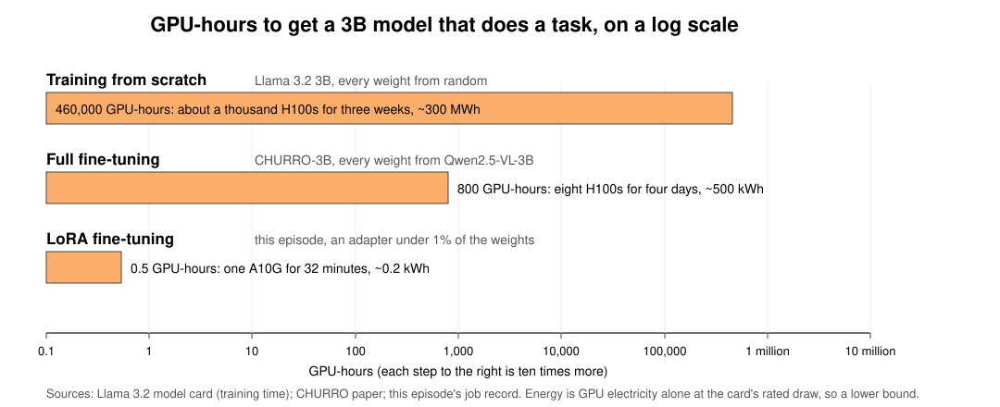

<!-- MARKDOWN COMMENT:
This Nexus page points to fine-tuning materials maintained in the
ML_with_AWS_SageMaker repository. Edit notebooks and scripts upstream;
edit the description and resource links here. With no Python cells, this page
is skipped by the qmd-to-ipynb GitHub Action.
-->

LoRA (low-rank adaptation) is how most research groups fine-tune a large pretrained model on one GPU. This lesson teaches it on a real task. We take [CHURRO-3B](https://huggingface.co/stanford-oval/churro-3B), a vision-language model for historical documents, and adapt it to handwritten German letters from the [Badger Scribe](https://uw-madison-datascience.github.io/ML-X-Nexus/Projects/ML-Marathon/Badger-Scribe.html) challenge. The letters are written in Kurrent, a historical script whose letterforms differ substantially from modern cursive. Even a model trained on historical documents struggles with it, which makes it a useful test of whether more fine-tuning helps.

The same fine-tune, with the same model, data and training script, runs in three places: a Google Colab notebook, an HTCondor job on UW-Madison's CHTC, and a SageMaker training job in the Intro to AWS workshop. What changes is who provides the GPU and how a job is described. Start with the Colab version. It needs nothing but a Google account, so the attention goes to the fine-tuning itself rather than the platform. Once that makes sense, try the other two; the [comparison below](#choose-where-to-run-it) says when each is the right choice.

## Why fine-tune, and why LoRA?

Training a model with billions of weights from scratch takes thousands of GPUs running for months. Pretrained models already know how to interpret images and language, and fine-tuning trains them a little further on examples from your own task, so a few hundred labeled pages do what millions would from scratch. Better prompting helps only so far: there are limits to what instructions can do when the model has never learned to recognize the writing itself.

CHURRO itself is an example. It is a 3-billion-parameter model that Stanford researchers fine-tuned from Qwen on roughly 100,000 historical document pages, and its authors report better transcription accuracy than Gemini 2.5 Pro at substantially lower inference cost ([paper](https://arxiv.org/abs/2509.19768)). The same pattern, a small specialist beating a much larger generalist on the task it was trained for, shows up in many places, including theorem proving and medical question answering.

, [Goedel-Prover-V2](https://arxiv.org/abs/2508.03613), [MedGemma](https://arxiv.org/abs/2507.05201).](../../images/specialists-vs-large-models.png)

**Full fine-tuning** updates every weight, and training needs far more GPU memory than running the model does: the weight, its gradient, a 32-bit master copy, and two optimizer averages, about 16 bytes per parameter. For CHURRO's 3.75 billion parameters that is about 60 GB before activations and other overhead: more than any 24 GB card, so the lesson sizes it as a four-GPU instance on AWS, and on CHTC it needs one of the 80 GB or larger cards.

**LoRA** leaves the pretrained weights frozen, at 2 bytes each with nothing else to store, and trains two thin matrices beside selected layers, under one percent of the model. The output is an adapter of about 100 MB that you save separately and load on top of the base model. **QLoRA** is LoRA with the frozen weights stored in 4-bit. Nothing about what the model learns changes; the frozen weights are read from a compressed copy, and the run needs about 6 GB.

| How CHURRO's 3.75B parameters are used | Bytes per parameter | GPU memory with activations | Where it fits |
|---|---|---|---|
| **Full fine-tune**, every weight updated | 16 | about 60 GB | A four-GPU cloud instance, or an 80 GB or larger CHTC card |
| **LoRA**, weights frozen in 16-bit | 2, plus the adapter | about 12 GB | One 24 GB card (the lesson's AWS GPU) or any CHTC GPU; a 16 GB T4 only just, and without bf16 |
| **QLoRA**, weights frozen in 4-bit | 0.5, plus the adapter | about 6 GB | Any of them, including Colab's free 16 GB T4 |

This is what makes LoRA useful for research groups. You can take an existing open-weight model, adapt it to your own data, check whether the adaptation helped, and keep the result, without the expense of full fine-tuning. On campus that is one CHTC GPU, one cloud GPU, or a free Colab T4.

## What you'll do

The data is 295 labeled pages from the Anna Seifert correspondence, letters written in Kurrent between 1932 and 1942 and transcribed by the Max Kade Institute. All three versions run the same training script with the same settings: 15% of the pages held out with a fixed seed, a LoRA adapter of rank 16, two passes over the remaining 251 pages, and a checkpoint at the end of each pass. Whichever version you run, the job:

1. Scores the base model on 15 held-out pages using character error rate (CER), the competition's own metric.
2. Trains the adapter for two epochs, scoring 8 of the held-out pages after each pass to build a learning curve.
3. Scores the fine-tuned model on the same 15 pages and saves the adapter, about 100 MB, along with the per-page scores, the loss and CER curves, and a summary.

The results are read the same way on all three. Before and after, on the same pages, says whether the fine-tune helped. The held-out CER curve, not the training loss, says whether more passes would have helped. If you want, the adapter can then transcribe the 141 unlabeled test pages with the lesson's batch transcriber.

What differs is the work around the script. In Colab you install three libraries, count tokens per page and adapter parameters by hand, and run a 20-page test before the full run. On CHTC you build a container, stage the model weights, and describe the job in an HTCondor submit file. On SageMaker you estimate the cost, launch a training job, tag it, and check the billable time afterward.

## Choose where to run it

| | [Google Colab](https://colab.research.google.com/github/carpentries-incubator/ML_with_AWS_SageMaker/blob/main/finetune_extras/colab/LoRA-finetuning-on-a-free-GPU.ipynb) | [CHTC](https://github.com/carpentries-incubator/ML_with_AWS_SageMaker/tree/main/finetune_extras/chtc) | [AWS SageMaker](https://carpentries-incubator.github.io/ML_with_AWS_SageMaker/08_Finetuning-BadgerScribe.html) |
|---|---|---|---|
| How it runs | Interactive notebook | HTCondor batch job; guide in development | Managed training job |
| Access | Google account | UW-Madison researchers and students, with a faculty sponsor | AWS account with payment method or credits |
| GPU used in the exercise | T4, 16 GB; 4-bit base model | Campus GPUs, including L40S, A100, H100 and H200 | A10G, 24 GB |
| Estimated run time | ~1.5 hours, subject to GPU availability | ~20 minutes after queue wait | ~33 minutes |
| Compute charge for this run | Free tier | Free | ~$0.75 at the documented rate |
| Additional skills | Making a model fit in limited GPU memory | Submitting jobs, staging data and working with containers | Estimating costs, tagging jobs and checking billable time |

**Colab** needs no research computing access, and it is a place to learn fine-tuning, not to do it for a project. The free tier gives a GPU when one is free, ends a session after a few hours of use or 90 minutes idle, and cuts back after heavy days. That is enough for this exercise. It is a poor fit for a research project, where runs repeat, data grows and results have to be reproducible months later. The notebook saves checkpoints to Google Drive, so a dropped session costs one epoch and not the run. A dataset ten times larger would outrun the session before the first checkpoint. Take what the notebook teaches to CHTC, or to the cloud when CHTC cannot do the job.

**CHTC** is the first choice for a UW-Madison research fine-tune. It is free, its GPUs are large, and the queue is the only price. The work has to be packaged as a batch job rather than run from a notebook. **The [CHTC guide](https://github.com/carpentries-incubator/ML_with_AWS_SageMaker/tree/main/finetune_extras/chtc) is still in development and has not been run end to end.** If you try it, [report problems](https://github.com/carpentries-incubator/ML_with_AWS_SageMaker/issues) with the job's `.log` and `.err` files.

**SageMaker** is for learning managed cloud training, or for a project that needs AWS. The [episode](https://carpentries-incubator.github.io/ML_with_AWS_SageMaker/08_Finetuning-BadgerScribe.html) is part of the workshop and assumes its setup: the bucket, the controller notebook and the IAM role from episodes 1 to 4, and the data already staged in S3. Its compute is billed while the job runs, so the episode estimates the cost before launching, caps the run time, tags the job, and compares the estimate with the billable minutes afterward. For research use, [UW Cloud Services](https://uw-madison-datascience.github.io/ML-X-Nexus/Toolbox/Compute/UW-Cloud-Services.html) covers UW-provisioned accounts.

The [National Research Platform (NRP)](https://uw-madison-datascience.github.io/ML-X-Nexus/Toolbox/Compute/NRP-Nautilus.html) is another free GPU option for UW-Madison researchers, through a hosted JupyterHub. There is no NRP version of this exercise yet.

#### Prerequisites

Whichever version you run, you should be comfortable with basic Python and with the ideas behind model training and evaluation:

- [**Workshop**: Intro to Machine Learning](https://uw-madison-datascience.github.io/ML-X-Nexus/Learn/Workshops/Intro-ML_Sklearn.html)
- [**Workshop**: Basic Python Programming](https://uw-madison-datascience.github.io/ML-X-Nexus/Learn/Workshops/Intro-Python_Gapminder.html)
- Recommended: [**Notebook**: Understanding Quantization and Precision](https://uw-madison-datascience.github.io/ML-X-Nexus/Learn/Notebooks/Quantization-and-Precision.html), for the 4-bit (QLoRA) loading used when the GPU is small

Each platform also has its own access requirements:

- **Colab**: a Google account, for Colab and for Google Drive, where checkpoints are saved.
- **CHTC**: a CHTC account, which needs a NetID and a faculty sponsor, plus GPU Lab access and a `/staging` directory (ask for both when you request the account). You'll work from the command line over SSH, on the campus network or VPN.
- **AWS SageMaker**: the workshop's setup. Episodes 1 to 4 of [Intro to AWS for ML/AI](https://uw-madison-datascience.github.io/ML-X-Nexus/Learn/Workshops/Intro-Amazon_SageMaker.html) create the S3 bucket and the small CPU notebook that launches the job, which runs as the lesson's `ml-sagemaker-use` role. In the shared UW-Madison workshop account the instructors stage the Badger Scribe data and the CHURRO-3B weights and hold the GPU quota. On your own account that is your job: a paid-plan account, a GPU quota request three to four weeks ahead, the role, and the data and model in your bucket. The [setup page](https://carpentries-incubator.github.io/ML_with_AWS_SageMaker/index.html#setup) has the steps.

#### Estimated time to complete

- **Colab**: **2–3 hours**, including roughly 1.5 hours of GPU work once a GPU is available.
- **CHTC**: a few days of calendar time for the account, an afternoon for the first container build and model staging, then about 20 minutes of GPU time per run plus its wait in the queue.
- **AWS SageMaker**: the job runs about 33 minutes. Allow an hour to launch it and read the bill, after the setup episodes. On your own account, GPU quota approval takes weeks.

## Related resources
- [ML on AWS lesson repository: finetune_extras](https://github.com/carpentries-incubator/ML_with_AWS_SageMaker/tree/main/finetune_extras) – All three versions of this exercise and their shared training code. Open issues there.
- [**Workshop**: Intro to AWS for ML/AI](https://uw-madison-datascience.github.io/ML-X-Nexus/Learn/Workshops/Intro-Amazon_SageMaker.html) – The parent lesson. Its fine-tuning episode is the SageMaker version of this exercise.
- [**Compute**: Center for High Throughput Computing (CHTC)](https://uw-madison-datascience.github.io/ML-X-Nexus/Toolbox/Compute/CHTC.html) – Free campus GPUs, job time limits, and which model sizes fit which GPU.
- [**Compute**: Google Colab](https://uw-madison-datascience.github.io/ML-X-Nexus/Toolbox/Compute/GoogleColab.html) – Plans, runtime limits, and mounting Google Drive for checkpoints.
- [**Compute**: National Research Platform (NRP)](https://uw-madison-datascience.github.io/ML-X-Nexus/Toolbox/Compute/NRP-Nautilus.html) – Free notebook-based GPU access for UW-Madison researchers.
- [**Compute**: UW-Madison Cloud Services (AWS, GCP, Azure)](https://uw-madison-datascience.github.io/ML-X-Nexus/Toolbox/Compute/UW-Cloud-Services.html) – UW-provisioned cloud accounts with institutional pricing and data protections.
- [**Project**: Badger Scribe](https://uw-madison-datascience.github.io/ML-X-Nexus/Projects/ML-Marathon/Badger-Scribe.html) – The MLM26 challenge whose Kurrent-script letters this exercise trains on.
- [**Notebook**: Understanding Quantization and Precision](https://uw-madison-datascience.github.io/ML-X-Nexus/Learn/Notebooks/Quantization-and-Precision.html) – FP16, BF16, INT8, and 4-bit formats and what they do to GPU memory.
- [**Library**: Hugging Face](https://uw-madison-datascience.github.io/ML-X-Nexus/Toolbox/Libraries/HuggingFace.html) – Where CHURRO-3B lives; the exercise uses `transformers`, `peft`, and `bitsandbytes`.
- [LoRA: Low-Rank Adaptation of Large Language Models (Hu et al., 2021)](https://arxiv.org/abs/2106.09685) – The original paper.
- [CHURRO: Making History Readable with an Open-Weight Large Vision-Language Model (EMNLP 2025)](https://arxiv.org/abs/2509.19768) – The model being fine-tuned.

## Comments
