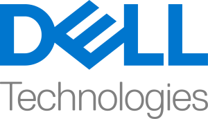
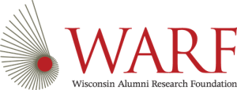

ML+X is UW-Madison's community of practice for people who use machine learning and AI in their work, whatever the field (the X). It is based in Madison, run out of the university, and primarily for university researchers and students, who meet to work through the problems and pitfalls of ML/AI, share resources, and help each other's projects along. Professionals working with AI in Madison are welcome to join and add their perspectives to the discussions and events. More at [ML+X's community page](https://dsi.wisc.edu/communities/mlx/).

## Join

Membership is free, and there is no application. Two places to sign up:

- **[The Google group](https://groups.google.com/a/g-groups.wisc.edu/g/ml-community-of-practice)** carries event announcements, the calendar invite for ML+Coffee, and the sign-up form sent before each session. You need to be signed in to a Google account; if the group refuses you, email [endemann@wisc.edu](mailto:endemann@wisc.edu).
- **[The Slack workspace](https://data-science-hubgroup.slack.com/signup#/domain-signup)**, channel `#ml-community`, is where conversation happens between events. Introduce yourself when you arrive.

## ML+Coffee

ML+Coffee is ML+X's main event, a monthly two-hour session that has grown from a coffee social into the community's working meeting. Sessions now usually open with one or two short presentations or demos from members on what they are building; recent ones covered LoRA fine-tuning and agentic AI for biological modeling, protein engineering with MaveDB, forecasting climate-related conflict, and sparse autoencoders for model interpretability. The rest of the time is open: bring a dataset and ask how ML/AI could apply to it, get unstuck on a project, or compare notes on tools and workflows. Researchers and students with little or no ML/AI background are welcome, and experienced practitioners are asked to bring advice as much as questions. Coffee and tea provided.

- **When:** monthly on a Wednesday, 9–11 AM. The Google group sends the calendar invite.
- **Where:** [Room 1145, Discovery Building](https://www.map.wisc.edu/?initObj=0212), first floor, west side, near the exit toward University Avenue.
- **To present or get help with a project:** fill in the sign-up form sent to the Google group a few days before each session.



Upcoming ML+X events are also listed under the [ML+X tag on the UW events calendar](https://today.wisc.edu/events/tag/ML%2BX).

## ML Marathon

The [Machine Learning Marathon](https://ml-marathon.wisc.edu/) is ML+X's semester-long hackathon, September to December each year. Teams of three to six pick a challenge from a slate of research problems, meet for weekly in-person sprint sessions, usually Wednesday evenings, and work asynchronously in between, with advisors for when a team is stuck. Challenges span skill levels and fields; recent ones have included coding agents on small open-weight models, transcribing 19th-century manuscripts with vision-language models, auditing a tampered neural network, predicting imagery from EEG, estimating deer populations from trail cameras, and RAG over the AI-and-sustainability literature.

- **Who:** anyone with a UW-Madison NetID, undergraduates through faculty and staff. Participants should know Python basics, machine learning fundamentals, and enough GitHub to collaborate; the [Intro to Python](https://uw-madison-datascience.github.io/ML-X-Nexus/Learn/Workshops/Intro-Python_Gapminder.html) and [Intro to Machine Learning](https://uw-madison-datascience.github.io/ML-X-Nexus/Learn/Workshops/Intro-ML_Sklearn.html) workshops cover the first two.
- **When to apply:** applications open in late summer, with a first review round in August and rolling admission until seats fill. The [Marathon site](https://ml-marathon.wisc.edu/) has the current challenges, schedule, rules and FAQ.
- **Past and current challenges** are written up under [Projects](https://uw-madison-datascience.github.io/ML-X-Nexus/Projects/ML-Marathon/) on this site.
- **Get involved:** the Marathon recruits advisors, presenters and volunteers each year through its [interest form](https://ml-marathon.wisc.edu/).

## Other ML+X activities

- **[Workshops](https://uw-madison-datascience.github.io/ML-X-Nexus/Learn/Workshops/)**: developed and taught with UW-Madison's [Carpentries community](https://hub.datascience.wisc.edu/communities/carpentries/), from Python and machine learning basics to cloud ML, fine-tuning and trustworthy AI.
- **Talks:** ML+X no longer runs a regular talk series, but if you would like to present your ML/AI work to a broad campus audience, email [endemann@wisc.edu](mailto:endemann@wisc.edu). Virtual talks can usually be arranged, and in-person ones with advance notice. [Recordings of past talks](https://uw-madison-datascience.github.io/ML-X-Nexus/Applications/Videos/Forums/) are on this site.
- **[EVIL reading group](https://uw-madison-datascience.github.io/evil-reading-group/)**: the Ethics, Values, Information and Law reading group, roughly every three weeks on Fridays, online, with the iSchool.
- **Your event:** a paper to discuss, a demo to give, a lunch social or a mini workshop. ML+X can help facilitate, advertise or host it. Email [endemann@wisc.edu](mailto:endemann@wisc.edu).

## Nexus

This site is the community's resource hub: workshops, guides, notebooks, models, datasets, compute options and stories from practitioners, contributed by members. See [How to contribute](https://uw-madison-datascience.github.io/ML-X-Nexus/Learn/Guides/How-to-contribute.html) to add a resource.

## Sponsors

ML+X's sponsors fund the coffee, the workshops, the Marathon's compute credits and the rest of what the community does. Thank you to AWS, Dell Technologies, Promega and WARF.

Organizations interested in supporting ML+X can read about [sponsorship benefits](https://dsi.wisc.edu/communities/mlx/mlx-sponsorship/).

## Leadership

[ML+X's community page](https://dsi.wisc.edu/communities/mlx/) lists the current leadership team. The team plans events and resources and welcomes new members, students included, with no minimum experience. To join, email [endemann@wisc.edu](mailto:endemann@wisc.edu) with a short note on your interest in machine learning and AI or in communities of practice.
